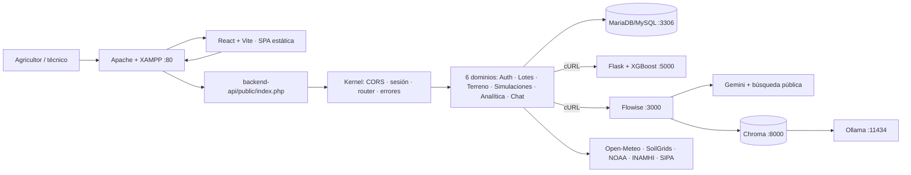

# ZeaSys: guía del sistema

Actualización original: 23 de noviembre de 2026. Ampliación documental: 23 de noviembre de 2026 (diccionario SQL, trazabilidad y evidencias). Este es el documento central y exhaustivo del proyecto: describe qué es, para quién sirve, qué contiene cada pantalla, cómo está construido, qué tecnologías y métodos utiliza, cómo se opera y cuáles son sus límites. Debe actualizarse cuando cambie una función, una conexión, una dependencia, una fuente de datos o una limitación relevante.

**Seguridad de este documento:** esta guía no contiene credenciales, claves de API, tokens, contraseñas, identificadores de cliente ni valores de configuración privados. Cuando una integración requiere configuración sensible, se menciona únicamente el **nombre de la variable de entorno** o el archivo de plantilla correspondiente, nunca su valor. Los valores reales pertenecen al entorno de ejecución y no deben versionarse ni distribuirse.

## Índice

- [Qué es y para quién sirve](#qué-es-y-para-quién-sirve)
- [Principios de información y clases de datos](#principios-de-información-y-clases-de-datos)
- [Recorrido habitual](#recorrido-habitual)
- [Qué contiene cada pantalla](#qué-contiene-cada-pantalla)
- [Arquitectura general](#arquitectura-general)
- [Tecnologías, versiones y herramientas](#tecnologías-versiones-y-herramientas)
- [Organización del repositorio](#organización-del-repositorio)
- [Backend: kernel, dominios y contratos](#backend-kernel-dominios-y-contratos)
- [Autenticación, sesión, permisos y seguridad](#autenticación-sesión-permisos-y-seguridad)
- [Datos: proveedores, referencias y base de datos](#datos-proveedores-referencias-y-base-de-datos)
- [Motor de simulación (Flask + XGBoost)](#motor-de-simulación-flask--xgboost)
- [Asistente, Flowise y recuperación documental](#asistente-flowise-y-recuperación-documental)
- [Diseño de interfaz](#diseño-de-interfaz)
- [Despliegue y operación](#despliegue-y-operación)
- [Pruebas y calidad](#pruebas-y-calidad)
- [Metodología y documentación](#metodología-y-documentación)
- [Límites y evidencia adicional](#límites-y-evidencia-adicional)
- [Mantenimiento de esta guía](#mantenimiento-de-esta-guía)
- [Documentación relacionada](#documentación-relacionada)
- [Diccionario de datos del esquema SQL publicado](#diccionario-de-datos-del-esquema-sql-publicado)
- [Correspondencia con los objetivos del PIS vigente](#correspondencia-con-los-objetivos-del-pis-vigente)
- [Estado verificable de funcionalidades y componentes](#estado-verificable-de-funcionalidades-y-componentes)
- [Metodología: investigación, software y ciencia de datos](#metodología-investigación-software-y-ciencia-de-datos)
- [Evidencias de pruebas: registro reproducible mínimo](#evidencias-de-pruebas-registro-reproducible-mínimo)
- [Criterios UX/UI definitivos: propuesta versus código vigente](#criterios-uxui-definitivos-propuesta-versus-código-vigente)
- [Límites técnicos y prioridades de corrección](#límites-técnicos-y-prioridades-de-corrección)
- [Control de versiones y proceso de actualización documental](#control-de-versiones-y-proceso-de-actualización-documental)
- [Glosario](#glosario)

## Qué es y para quién sirve

ZeaSys es un **sistema de apoyo a decisiones agrícolas** para parcelas de maíz en Ecuador. Está dirigido a agricultores y a quienes los acompañan (técnicos, extensionistas, equipo docente): permite ubicar una parcela, preparar una campaña, consultar el clima, simular escenarios de cosecha, valorar el resultado económicamente y entenderlo con ayuda de un asistente conversacional.

La información debe responder tres preguntas: **qué está ocurriendo, qué puede significar para el cultivo y qué se puede revisar o hacer a continuación**. Los nombres de variables, estadísticas y detalles de infraestructura no deben ser necesarios para usarla.

La aplicación reúne información del productor, referencias públicas, estimaciones meteorológicas y resultados de modelos. Esas clases de datos tienen distinto alcance: un pronóstico no es una medición en la parcela; una simulación no es una cosecha real; una guía provincial no confirma una enfermedad presente en el lote.

## Principios de información y clases de datos

| Clase | Ejemplos | Interpretación correcta |
|---|---|---|
| Declarados por el productor | Fecha real de siembra, riego, observación, peso cosechado | Se conservan con su contexto y fecha; el sistema no los verifica de forma independiente. |
| Referencias institucionales | INIAP, MAG/SIPA, INAMHI, INEC/ESPAC, Agrocalidad, FAO/IIASA, NOAA | Se conservan edición, periodo, territorio, unidad y fuente. No se trasladan automáticamente a una parcela. |
| Estimaciones por ubicación | Open-Meteo, SoilGrids, NASA POWER | Son resultados de modelos o mapas. No sustituyen sensores o análisis de laboratorio en el lote. |
| Cálculos del sistema | Producción por área, balance descriptivo, presupuesto, fechas aproximadas | Debe indicarse qué entradas se utilizaron. Un dato ausente no se convierte en cero. |
| Resultados de IA | Predicción XGBoost y explicación del asistente | Se distinguen de una cosecha medida y de una afirmación institucional. La explicación generativa puede requerir comprobación. |

Reglas de interpretación vigentes:

- En **Clima y cultivo**, el recorrido es: tiempo disponible ahora, próximos siete días, observaciones registradas, historia reciente y referencias adicionales. Los botones de las tarjetas y el título del gráfico abren el asistente con la pregunta correspondiente. «Registrar observación» abre el registro de campo; la última etapa se muestra con la fecha declarada y no se deduce de un número fijo de días desde la siembra.
- El historial alterna lluvia y temperatura, con períodos de 30 días o doce meses completos de calendario. Puede consultarse también como tabla. Un día sin datos queda vacío: no se suma como cero, y no se publica un total semanal o mensual de lluvia si está incompleto. La diferencia lluvia menos ET₀ requiere días coincidentes y completos; no es una dosis de riego. Las estimaciones de agua en los primeros 10 cm se expresan como porcentaje del volumen, sin clasificar todas las texturas como secas u óptimas por el mismo límite.
- La referencia de NOAA utiliza **RONI**, el índice empleado para el seguimiento oficial desde febrero de 2026. Se muestra el trimestre y su alcance regional; la aplicación no declara un episodio oficial ni convierte el índice en un riesgo para la parcela. Si falla una actualización de clima, se conserva la consulta anterior con sus fechas y se ofrece reintentar.
- La tarjeta **El Niño y La Niña** relaciona la referencia del Pacífico con la fecha de siembra declarada: si el cultivo está en campo, muestra la condición que rodeó esa siembra; si la siembra es futura, advierte que la fase puede cambiar; si no hay fecha, invita a completarla en Siembra; si el ciclo terminó, sirve para comparar con lo observado. El pronóstico de 7 días sigue siendo la guía de la parcela.
- La referencia anual de lluvia no es la lluvia de toda una campaña. Temperatura de hoy, pronóstico y promedio de los últimos treinta días se presentan por separado. Una posibilidad de lluvia no es un porcentaje de riesgo de perder la cosecha. Conviven las unidades heredadas `mm/año` y las del catálogo del modelo `mm/ciclo`; la aplicación conserva la advertencia en vez de convertir un valor por otro, y prefiere el campo explícito `precipitacion_ciclo_mm`.
- El catálogo de maíz contiene **catorce fichas identificadas** (13 con etiqueta utilizable y una ficha de consulta sin cálculo; 24 opciones retiradas). Se diferencian los usos documentados de grano, choclo y canguil. Una ficha de variedad no convierte automáticamente el modelo de grano seco en un modelo validado para otro producto.

El inventario detallado de fuentes y de los lugares del código que las utilizan está en el documento Word de referencias de datos y en su inventario JSON, dentro de `documentacion/evaluaciones/`.

## Recorrido habitual

1. El productor inicia sesión y crea o selecciona una parcela.
2. Revisa su ubicación, superficie, tipo de maíz y variedad.
3. En **Siembra** organiza la fecha, la duración y el agua o riego previsto.
4. En **Clima y cultivo** consulta el tiempo disponible y lo que conviene observar en campo.
5. En **Simular cosecha** confirma las entradas y calcula un escenario.
6. En **Rendimiento** interpreta el resultado y compara ejecuciones guardadas.
7. Usa **Finanzas** si desea valorar un presupuesto y el precio referencial.
8. Registra observaciones reales y consulta el asistente cuando no entiende un dato o necesita orientación.

## Qué contiene cada pantalla

| Pantalla | Para qué sirve | Información y acciones principales |
|---|---|---|
| Página pública y acceso | Explicar el servicio y entrar a la cuenta | Presentación, capacidades, datos/modelos, contacto, acceso con correo y Google según configuración. Portada fluida a todo el ancho con tope amplio. |
| Mis parcelas | Mantener los datos propios del agricultor | Nombre, ubicación, superficie, límites o coordenadas, variedad y datos de apoyo del terreno. La información autocompletada se identifica y puede corregirse. |
| Simular cosecha | Preparar un escenario de producción | Área, temperatura, humedad, lluvia del ciclo, nitrógeno como nutriente, pH, textura, fecha, duración, riego y datos opcionales. Decimales y unidades se validan antes de enviar al motor. |
| Rendimiento | Entender una simulación y revisar pruebas anteriores | Rendimiento por hectárea, producción total para el área utilizada, rango orientativo, alternativas climáticas, aportes del modelo e historial de la parcela. |
| Siembra | Organizar el cultivo antes de simular | Plan editable, fecha prevista o real declarada, duración, riego, fin aproximado y calendario propio. Calendario agrícola por zona/grupo de maíz con fuentes institucionales, suelo y antecedentes sanitarios. |
| Clima y cultivo | Consultar el tiempo y relacionarlo con las observaciones del productor | Panel de estado del clima y del cultivo (Pacífico/ENSO, probabilidad de lluvia, agua en suelo, lectura compuesta de riesgo y etapas fenológicas), condiciones actuales, pronóstico, evolución reciente, referencias históricas y estimaciones del suelo. La información regional se distingue de la correspondiente a la parcela. |
| Finanzas | Explorar el resultado económico de un escenario | Precio referencial, costos declarados, producción estimada, ingresos, margen y sensibilidad. No equivale a una cotización de compra garantizada. |
| Mapa de parcelas | Ubicar y consultar las parcelas guardadas | Localización y geometría de la cuenta (Leaflet + Geoman). Las capas públicas se identifican como referencias, no catastros certificados. |
| Simulaciones guardadas | Recuperar y comparar cálculos anteriores | Historial con fechas, entradas y resultados conservados. No son registros de cosecha real. |
| Registro de campo | Incorporar lo que el productor sí ha observado o medido | Observaciones del cultivo y de plagas, fechas, datos de cosecha y de agua del suelo. Se guardan como datos declarados. |
| Acompañamiento técnico | Compartir parcelas con un técnico | Accesos otorgados y revocados por el titular, lectura de parcelas compartidas, cosechas, mediciones y última observación, y exportación CSV autorizada. |
| Configuración | Administrar la cuenta y obtener una copia de los datos | Perfil, foto, nombre, acceso, sesión, tema claro/oscuro y descarga selectiva de información en JSON/PDF. |
| Asistente | Aclarar términos, cifras, dudas y próximos pasos | Conversación con contexto de la parcela y la pantalla; explicaciones de Gemini, búsqueda pública cuando está disponible, documentos de apoyo y favoritos. |

## Arquitectura general

ZeaSys adopta **microservicios lógicos sobre XAMPP** (ADR-001): varios dominios con interfaces y capas bien separadas que conviven en un mismo servidor, sin orquestación de contenedores en la entrega académica. El frontend es una SPA servida estáticamente por Apache; la API PHP expone rutas REST con sesión; el motor Python calcula escenarios; Flowise/Gemini atienden al asistente; Chroma y Ollama participan solo en la recuperación documental auxiliar.



**Regla de dependencia:** `Http → Aplicación → Dominio ← Infraestructura`. El controlador es delgado, el servicio contiene la lógica de caso de uso y el repositorio o cliente externo implementa la interfaz del dominio. El contenedor DI es manual, con fábricas explícitas y una instancia por petición (ADR-006).

**Flujo de una petición:** Apache → `public/index.php` → CORS y preflight → sesión → manejador de errores tipados → router declarativo → middleware → contenedor → controlador → servicio → repositorio/PDO o cURL → `RespuestaJson`.

**Decisiones arquitectónicas (ADR):**

| ADR | Decisión | Consecuencia principal |
|---|---|---|
| ADR-001 | Microservicios lógicos sobre XAMPP, dominios en cuatro capas | Despliegue sencillo sin servicios físicos separados. |
| ADR-002 | Kernel sin framework, autoloader PSR-4 manual, sin Composer | Control total y cero dependencias de librerías del backend. |
| ADR-003 | Router declarativo con tabla única (`rutas.php`, flags `publica`/`sesion`) | Una sola fuente de verdad para rutas y su protección. |
| ADR-004 | Contratos congelados y suite de contrato (29 pasos) | Cambios de respuesta detectados antes de desplegar. |
| ADR-005 | Strategy de explicabilidad: 46 estrategias en orden de matching fijo | Explicaciones reproducibles y ordenadas por especificidad. |
| ADR-006 | Contenedor DI manual con fábricas explícitas | Sin reflexión ni autowiring; singleton por petición. |
| ADR-007 | Deuda técnica aceptada por paridad | Se documenta en vez de ocultarse; debe revisarse antes de exponer el sistema públicamente. |

## Tecnologías, versiones y herramientas

Las versiones son las declaradas en los manifiestos y las resueltas en los archivos de bloqueo; se incluyen las verificadas en la revisión de noviembre de 2026.

### Frontend (`frontend-app/`)

| Tecnología | Versión | Uso |
|---|---|---|
| React / React DOM | 19.2.7 | SPA con `lazy` y `Suspense` en `App.jsx`. |
| Axios | 1.20.0 | Cliente API con `withCredentials`, timeout de 45 s e interceptor de sesión. |
| ECharts | 5.6.0 | Gráficos de barras, líneas y tortas; componente Aria y locale español. El gráfico del sistema es ECharts; no se usa Chart.js. |
| Leaflet + Leaflet-Geoman | 1.9.4 / 2.20.2 | Mapa de parcelas y dibujo de geometrías; `window.L` inyectado desde `vite.config.js`. |
| Three.js | 0.186.1 | Modelo 3D de la mazorca (MTLLoader y OBJLoader). |
| Lucide React | 1.18.0 | Iconografía con chunk propio en el build. |
| Vite + plugin React | 8.3.6 / 6.x | Bundler basado en Rolldown; compresión gzip estática de recursos ≥ 4 KB. |
| ESLint | 10.14.0 | Lint con configuración plana y plugins de hooks/refresh. |
| TypeScript | 7.0.2 | Chequeo piloto (`tsconfig.pilot.json`), no migración total. |
| Playwright | 1.65.0 | Pruebas E2E con canal Chrome. |
| Inter / JetBrains Mono | — | Tipografías cargadas desde Google Fonts. |

### Backend (`backend-api/`)

- PHP 8.2 sobre Apache, sin Composer ni framework; autoloader PSR-4 propio.
- PDO MySQL con `utf8mb4`, modo excepción y sentencias preparadas sin emulación.
- Front controller `backend-api/public/index.php`; configuración centralizada en `src/Config/` (base de datos, rutas, contenedor, constantes de negocio e integración de Google).
- cURL para comunicarse con el motor Flask, Flowise y proveedores públicos.
- Suites de prueba propias ejecutables con `php` (no hay PHPUnit).

### Motor de simulación (`ml-engine/`)

| Dependencia | Versión |
|---|---|
| Flask / Flask-CORS | 3.1.3 / 6.0.2 |
| NumPy / pandas | 2.4.4 / 2.2.3 |
| XGBoost / scikit-learn | 3.2.0 / 1.8.0 |
| SHAP / joblib | 0.51.0 / 1.5.3 |

Python 3.11 de 64 bits. Versión del motor: 2.6.0, expuesta en `/health`.

### Entorno, despliegue y herramientas

- XAMPP: Apache en puerto 80 y MariaDB/MySQL en 3306. Node compatible con Vite 8 (20.19+ o 22.12+); la revisión local documenta Node 24.16.0.
- Flowise 3.x en puerto 3000; Chroma 0.5.23 en 8000; Ollama 0.40.5 en 11434 (perfil opcional del asistente).
- Docker compose experimental en `docker/`: `mariadb:10.11`, Chroma, Ollama, Flowise y dos imágenes propias (`Dockerfile.web`, `Dockerfile.motor`). **No es la entrega validada**; ver `docker-preparacion.md`.
- PWA: `manifest.webmanifest`, `sw.js`, `offline.html`, `privacidad.html`, favicon e iconos. El service worker cachea recursos con hash y la página offline; **no intercepta la API**.
- Utilidades en `tools/`: auditorías visuales (`auditar_*.cjs`), indexación RAG, evaluación de recuperación, importación de fuentes oficiales, respaldos y paquete de revisión.

La configuración sensible se declara mediante variables de entorno (por ejemplo, base de datos, URLs internas, identificadores de integración, claves de proveedores y cuotas del chat). Los nombres están documentados en las plantillas `.env.example` y en `src/Config/`; **sus valores nunca se incluyen en este documento ni en el repositorio**.

## Organización del repositorio

```text
ZeaSys/
├─ frontend-app/            Fuente React + Vite
│  ├─ src/views/            10 vistas (Login, Cultivos, Simular, dashboards, History, MapPage, Configuración)
│  ├─ src/components/       25 componentes (ChatbotWidget, PantallaCarga, EChart, AgriculturalCalendar, …)
│  ├─ src/templates/        Common/ y Charts/
│  ├─ src/hooks/ · services/ · utils/ · data/
│  ├─ src/assets/           CSS por módulo + imágenes landing/
│  ├─ public/models/maiz/   Recursos 3D
│  ├─ tests/e2e/            19 specs Playwright
│  └─ copy-build.js         Sincronización del build al despliegue
├─ backend-api/
│  ├─ public/index.php      Front controller
│  ├─ src/Kernel/           Autoloader, router, contenedor, petición/respuesta, CORS, middleware, errores
│  ├─ src/Config/           Base de datos, rutas, DI, constantes e integraciones
│  ├─ src/Dominios/         Autenticacion, Lotes, Terreno, Simulaciones, Analitica, Chat
│  ├─ data/referencias/     Catálogos y corpus de referencia versionado
│  └─ tests/                kernel, analitica, chat, validacion, simulaciones, variedades,
│                           autenticacion, explicacion, terreno, contrato, integracion
├─ ml-engine/
│  ├─ app.py                Servidor Flask
│  ├─ src/                  11 módulos (feature_builder, predictor, data_providers, …)
│  ├─ models/               Artefactos joblib + metrics.json
│  ├─ data/ · scripts/ · experiments/ · tests/
├─ flowise-nodes/ZeaSysGeminiSearch/   Nodo personalizado de Flowise
├─ database/                schema-demo.sql y migraciones/
├─ documentacion/           Esta guía, ADR, arquitectura, evidencias e historial
├─ scripts/                 Lanzadores, verificación, respaldo y paquete de revisión
├─ tools/                   Indexación RAG, evaluación, importadores y auditorías
├─ rag-sources/             Corpus PDF + SOURCES.md
└─ assets/, models/, icons/, index.html, sw.js, …  Resultado desplegado servido por Apache
```

Las carpetas duplicadas son intencionales: `frontend-app/` es la fuente y la raíz contiene el artefacto que XAMPP sirve. Los archivos generados se editan solo mediante `npm run build`.

## Backend: kernel, dominios y contratos

**Seis dominios**, cada uno con `Dominio/` (interfaces), `Aplicacion/` (casos de uso), `Infraestructura/` (persistencia y clientes) y `Http/` (controladores):

| Dominio | Responsabilidad |
|---|---|
| Autenticacion | Registro, ingreso con correo o Google, perfil, avatar y cierre de sesión. |
| Lotes | Parcelas, mapa, valores de ubicación y acceso de técnicos. |
| Terreno | Proveedores de clima, suelo, lluvia, NOAA y precios. |
| Simulaciones | Cálculo con el motor, evaluación de variedades, historial y explicabilidad. |
| Analitica | Rendimiento, campañas, mediciones, escenarios, clima y finanzas. |
| Chat | Consentimiento, preguntas, memoria, favoritos, cuotas y recuperación documental. |

**Rutas HTTP** (fuente real: `backend-api/src/Config/rutas.php`; los nombres están en español):

- `api/salud`
- `api/auth/`: `iniciar-sesion`, `registrarse`, `google-iniciar-sesion`, `yo`, `cerrar-sesion`, `actualizar`, `subir-avatar`, `eliminar-avatar`, `sincronizar-avatar-google`, `eliminar-cuenta`
- `api/parcelas` (GET/POST/PUT/DELETE), `/mapa`, `/valores-ubicacion`
- `api/acompanamiento` (+ `/accesos`, `/exportar`)
- `api/simulaciones/`: `simular`, `evaluar-variedades`, `historial`, `eliminar`, `estado-ia`, `explicar`
- `api/chat/`: `consentimiento`, `preguntar`, `limpiar`, `favorito`, `favorito/eliminar`
- `api/rendimiento` y `/campanas` (cosecha, observación, adjunto), `/mediciones` y `/mediciones/consulta`
- `api/escenarios`, `api/clima`, `api/clima/avisos`, `api/financiero`
- `api/whatsapp/webhook` (pública, con firma verificada)

El frontend consume exactamente estas rutas desde `src/services/api.js`. La tabla de rutas en `arquitectura.md` conserva aliases antiguos en inglés; en caso de duda manda `rutas.php`.

**Contratos congelados (ADR-004):** la suite de contrato ejecuta 29 pasos reales contra la API, normaliza campos volátiles y tolera diferencias numéricas de ±25 %, con códigos de salida 0 (éxito), 1 (fallo) y 2 (error de ejecución). No se ejecuta por omisión en el verificador porque crea registros.

**Explicabilidad (ADR-005):** 45 reglas ordenadas en `RegistroExplicadores.php` más `ExplicadorDefault` = 46 estrategias con interfaz `explicar(array): array`. El orden de matching es parte del contrato: cuatro reglas son inalcanzables por *shadowing* y se conservan por compatibilidad. La orquestación la hacen `ServicioExplicabilidad`, `ResolutorContextoExplicacion`, `EvaluadorCondiciones` y `CatalogoIndicadores`.

## Autenticación, sesión, permisos y seguridad

- **Correo y contraseña:** hash bcrypt con prefijo de versión no secreto y semántica de contraseña exacta (se rechazan bytes nulos y longitudes superiores a 72 bytes). El registro exige 8–72 caracteres con mayúscula, minúscula, número y símbolo. El detalle está en `backend-api/src/Dominios/Autenticacion/CONTRASENAS.md`.
- **Google OAuth:** el landing carga Google Identity Services y envía el `id_token` a `api/auth/google-iniciar-sesion`; `VerificadorTokenGoogle.php` valida el token contra el servicio oficial, exige correo verificado y comprueba la audiencia contra el identificador configurado (variable `VITE_GOOGLE_CLIENT_ID`, plantilla `frontend-app/.env.example`). No se emite JWT propio.
- **Sesión:** cookie `AGROPREDICT_SESSION` con `HttpOnly`, `SameSite=Lax` y `Secure` solo en HTTPS; se regenera el identificador al iniciar sesión. Caduca por inactividad de una hora, o de 30 días con «Recordar sesión». `AutenticacionMiddleware` comprueba usuario activo y cierra la sesión salvo en rutas marcadas con flag `sesion`.
- **Permisos:** no hay tabla de roles globales. Existe el flag `activo` por usuario y el modelo de **acceso por parcela** (`accesos_tecnicos`): solo el titular otorga o revoca; el técnico obtiene lectura de parcelas compartidas, cosechas, mediciones y última observación, además de exportación CSV autorizada.
- **CORS y cabeceras:** `Kernel/Cors.php` permite el mismo origen y una lista de orígenes locales de desarrollo; verifica `Origin`, `Referer` y `Sec-Fetch-Site` en escrituras y responde 204 a `OPTIONS`. `.htaccess` aplica `Options -Indexes`, `nosniff`, `SAMEORIGIN`, `Referrer-Policy`, `Permissions-Policy`, bloqueo de rutas internas y extensiones sensibles, compresión y caché.
- **Asistente:** el consentimiento se versiona en la base de datos; `CuotaChat.php` aplica límites diario y por minuto configurables mediante variables de entorno (solo nombres, sin valores). Las instrucciones del sistema prohíben revelar contexto interno o credenciales.
- **Deuda conocida (ADR-007):** se documenta como pendiente de revisión antes de una exposición pública: 'IDOR en `explain()`, falta de rate-limiting, DDL heredado, `getConnection()` global y uso de `mt_rand`'. El código actual ya verifica TLS en Google y limpia avatares al eliminar cuentas, aunque el ADR conserva el registro histórico.

**Regla de oro:** ninguna clave, token o dato personal se escribe en el código, en la documentación ni en un mensaje de commit. La configuración real vive en el entorno de ejecución; las plantillas solo muestran nombres de variables.

## Datos: proveedores, referencias y base de datos

| Proveedor | Uso principal |
|---|---|
| Open-Meteo Forecast / Archive / Geocoding | Clima actual, humedad del suelo por capas, ET₀, pronóstico de 7/16 días, reanálisis histórico y geocoding. |
| NASA POWER | Respaldo diario si falla Open-Meteo. |
| SoilGrids (ISRIC) | pH, arcilla, arena, limo y materia orgánica (WMS en PHP, REST en Python). |
| INAMHI | Serie mensual de estación cercana y climatología; CSV locales en `ml-engine/data/`. |
| NOAA CPC | Índice ENSO y RONI desde febrero de 2026, sin declarar episodio oficial. |
| MAGP / SIPA | Precio referencial del maíz y boletín mensual por provincia, con fecha de fuente. |
| INIAP, MAG, INEC/ESPAC, FAO/IIASA, Agrocalidad | Catálogos, guías, referencias documentales y estadísticas. |
| Meta WhatsApp Business | Avisos semanales de lluvia (webhook con firma, alta y baja por mensaje). |

La semántica de calidad se conserva (`model`, `reanalysis`, `unavailable`); los datos ausentes no se convierten en cero y el precio oficial es una referencia, no una cotización.

**Referencias versionadas** en `backend-api/data/referencias/`: catálogo de maíz, variedades verificadas, entradas de campo, tipos de suelo, provincias, calendario agrícola, precios por provincia, planificación mensual ESPAC,contraste de ediciones e índices del corpus RAG. Las cachés de proveedores se regeneran solas y están excluidas de Git.

**Base de datos:** el esquema sin datos personales es `database/schema-demo.sql`, con 11 tablas: `usuarios`, `parcelas`, `simulaciones`, `conversaciones_favoritas`, `mediciones_rendimiento`, `cosechas_campana`, `observaciones_campana`, `consentimiento_asistente`, `alertas_lluvia`, `envios_alertas_lluvia` y `accesos_tecnicos`. Incluye claves foráneas con `CASCADE`/`SET NULL` e índices por usuario, parcela y fecha. Las simulaciones guardan entradas, rendimiento, `shap_json`, `escenarios_json` y la versión del modelo.

**Migraciones aditivas** (11 archivos) en `database/migraciones/`: xgboost único, favoritos del chat, mediciones de rendimiento, renombrado de tablas, texturas de suelo, planificación de parcela, acompañamiento, alertas de lluvia, campañas, consentimiento e índice de simulaciones por parcela. Nunca se reemplaza una base existente para actualizar una pantalla.

**Exportaciones:** JSON y PDF selectivos desde Configuración (`prepararExportacion.js`, `exportarPdf.js`, con escape HTML y encabezados semánticos) y CSV de parcelas autorizadas a técnicos. No se incluyen conversaciones ni configuración interna del asistente.

## Motor de simulación (Flask + XGBoost)

- **Endpoints:** `GET /`, `/health`, `/metrics`, `/stats` y `POST /predict`. Límite de cuerpo 1 MB; CORS configurable; errores 400/413/415/500.
- **Modelos:** regresión y clasificación XGBoost con codificadores y `metrics.json`; la versión reportada es un hash truncado del artefacto; `TreeExplainer` de SHAP aporta la explicación. Solo `xgboost` está disponible.
- **36 características** en orden estricto (`COLS_ORDER`): zona, provincia, variedad, tipo de grano, riego, tipo de suelo, pH, materia orgánica, profundidad, arcilla/arena/limo, altitud, temperatura media/mín/máx, precipitación, humedad, horas de luz, densidad, ciclo, nitrógeno, fósforo, potasio, magnesio, azufre, aplicaciones de nitrógeno, lámina de riego, biofertilizante, semilla certificada, NDVI (V6/VT/R3), plagas, presión de plaga y control de plaga. Ocho son categóricas.
- **Entradas `/predict`:** obligatorias temperatura, humedad, precipitación, fertilizante, pH, área y tipo de suelo; opcionales variedad, tipo de maíz, ubicación, altitud, coordenadas, `precipitacion_ciclo_mm`, 11 campos de parcela validados contra `entradas-campo.json`, fecha de siembra y banderas de consulta. Contrato `contrato_campo: 1.0`.
- **Salidas:** rendimiento estimado (recortado a 0.5–12 t/ha), producción total, categoría y probabilidad de cosecha, intervalo de rendimiento, confianza (calidad global R², no probabilidad), valores SHAP, explicación del modelo, entradas utilizadas, sensibilidad a ±20 % de lluvia y nitrógeno, tres escenarios (lluvioso, verano, sequía), precisión de datos, trazabilidad, métricas y versión del modelo.
- **Métricas reales:** regresión MAE 0.8166, RMSE 1.0442, R² 0.5820; clasificación accuracy 0.5796 y F1 0.5527. Validación `GroupKFold` por provincia (5 pliegues), 2266 filas utilizadas de 2366 originales, 100 duplicados eliminados y 22 provincias. El dataset de entrenamiento tiene procedencia pendiente de acreditación.
- **Operación:** `retrain_models.py` reentrena con respaldo y comparación de RMSE; los experimentos se aíslan con banderas de depuración; hay scripts de evaluación con cosechas verificadas y fuentes oficiales.

El cliente PHP (`ClienteMotorFlask.php`) usa cURL con timeouts de 10 y 30 segundos; `SimulacionService.php` valida pertenencia de la parcela, rango de área, tipo de suelo y resuelve los explicadores.

## Asistente, Flowise y recuperación documental

El asistente combina cuatro elementos: la pregunta y la conversación de la parcela; datos autorizados reconstruidos por el servidor (parcela, pantalla, simulación seleccionada y referencias); conocimiento general de Gemini con búsqueda pública cuando el proveedor la permite; y fragmentos documentales cuando se pide una guía o fuente concreta.

- **Flujo principal:** Flowise con Gemini (modelo configurable), `Conversation Chain`, memoria de resumen, temperatura 0.2 y salida máxima de 1200 tokens. El contexto autorizado se compacta con presupuestos documentados (3200 caracteres de JSON y 4000 del mensaje). El `sessionId` combina usuario, parcela, año, ámbito y conversación; una simulación nueva usa ámbito propio con su borrador.
- **Ruta directa opcional:** `GeminiDirecto.php` con streaming SSE (`Accept: text/event-stream`), modo simple, cuota y caché; la clave del proveedor solo existe en la credencial configurada del entorno.
- **Flujo documental auxiliar:** cadena de recuperación sobre Chroma (colección documentada en `rag-cinco-pdf.md`) con embeddings locales de Ollama, hasta tres fragmentos citados con archivo y página, timeout de 20 s y *fallback* sin red. `RecuperadorChroma.php` implementa recuperación híbrida BM25 + densa con reranking y validación de fuentes permitidas.
- **Nodo personalizado:** `ZeaSysGeminiSearch.js` extrae metadatos de fundamentación, filtra URLs públicas, reintenta sin búsqueda cuando la cuota se agota y devuelve información de proveedor, fuentes y modo.
- **Corpus:** cinco PDF oficiales (INIAP 2007/2014/2021, MAG 2026 e INEC/ESPAC 2025) con 1755 fragmentos iniciales. El OCR puede contener errores en tablas; las reglas de uso están en `rag-sources/SOURCES.md`.
- **Instrucciones del sistema:** 11 reglas (responder en español cotidiano, no inventar cosechas, dosis ni diagnósticos, distinguir referencia pública de medición, respetar la semántica de milímetros y probabilidad, no revelar JSON, contexto ni credenciales, y no enviar datos privados a la búsqueda). Se replican en el nodo de Flowise.
- **Comportamiento verificado (15/11/2026):** Gemini responde a preguntas generales y a casos con datos faltantes; la búsqueda pública devolvió cuota excedida, por lo que el asistente conservó la orientación general sin afirmar verificación en internet. Restablecer esa cuota depende de la cuenta del proveedor.

La conversación se conserva por cuenta, parcela, año y ámbito. Los favoritos se guardan en la cuenta; limpiar la conversación elimina el historial visible y reinicia su memoria.

## Diseño de interfaz

**Modelo de tres capas de tokens:** primitivos → semánticos → alias de componente.

| Capa | Archivo | Ámbito |
|---|---|---|
| Paleta base | `src/assets/palette.css` | Ocho colores por tema (claro y oscuro) con derivados por `color-mix` y puente `--zp-*`. |
| Portada | `src/assets/landing-system.css` | `.zeasys-home` / `Login.jsx`: rampas HSL, espaciado, radios, duraciones, `--home-max: 1760px`, `--home-pad`. |
| Interior | `src/assets/internal-system.css` | `.zeasys-workspace`: tokens `--zi-*`, puente a la paleta, variante clara, sidebar de 246 px, colores de gráfico. |
| Analítica | `src/assets/analytics-system.css` | Capa final que unifica paneles, encabezados, KPI, tablas, leyendas y estados vacíos de todas las pestañas internas. |
| Estado climático | `src/assets/climate-status.css` | Panel oscuro de Clima con contornos, tarjetas de señales y riel de etapas fenológicas; usa `src/components/ClimateStatusPanel.jsx`. |

Los canvas comparten `getChartBase()` en `src/utils/chartConfig.js` (rejilla discontinua, ejes sin línea, leyenda arriba, tipografía y animación coherentes); los tooltips usan `getChartTooltip()` con formato en español y los valores se formatean con `formatChartValue()`.

La portada usa el hero fotográfico con dirección de arte oscura idéntica en ambos temas: el modo claro cambia las superficies alrededor, no la foto. El contenedor es fluido con tope amplio, de modo que navbar, hero, secciones y footer comparten el mismo eje y la lectura conserva medida. Los párrafos largos se limitan a ~72 caracteres. La aplicación interior usa semántica de color compartida y gráficos con paleta petróleo/salvia, ejes suaves, tooltips en español, leyendas claras y estados sin datos.

**Accesibilidad y responsive:** mobile-first, objetivos táctiles mínimos de 44 px, `:focus-visible` visible, HTML semántico, `aria-label`/`aria-expanded`/`inert`, estados `role=status`/`alert`, `prefers-reduced-motion`, *skip link* y navegación móvil. Se verifican 360/390/768/1024/1440/1920 px en claro y oscuro. ECharts activa AriaComponent y locale español; los mapas tienen ayudas de accesibilidad.

**Componentes compartidos:** `PantallaCarga` unificado (brote de maíz animado, puntos y esqueletos con colores del tema, con soporte de movimiento reducido), `EChart`, `ChatbotWidget` (oculto en Mis parcelas y Configuración) y selector de parcela.

```bash
npm run dev        # Vite en puerto 5500
npm run build      # vite build && node copy-build.js → sincroniza el despliegue en la raíz
npm run lint       # ESLint
npm test           # node --test src/utils/*.test.mjs
npm run test:e2e   # Playwright
```

## Despliegue y operación

| Servicio | Dirección habitual |
|---|---|
| Aplicación web | `http://localhost/ZeaSys/` |
| Apache/XAMPP | Puerto 80 |
| MariaDB/MySQL | Puerto 3306 |
| Motor de simulación | `http://127.0.0.1:5000/` |
| Flowise | `http://127.0.0.1:3000/` |
| Chroma | Puerto 8000 |
| Ollama | Puerto 11434 |

- `scripts/iniciar_sistemas.bat` comprueba los puertos y levanta lo que falte sin duplicar servicios. Hay lanzadores individuales para el motor, Chroma, Ollama y Flowise.
- `copy-build.js` copia `dist/` a la raíz, valida los archivos gzip, mantiene un manifiesto y retira recursos obsoletos. Los artefactos de la raíz se versionan a propósito para poder revertir el despliegue.
- `api/salud` y `GET /health` permiten comprobar el estado de la API y del motor.
- Los respaldos se crean y verifican con SHA-256 desde `tools/respaldo_local.py` y scripts asociados; la tarea programada prueba la restauración en una base temporal. Los destinos deben ser privados y ajenos al directorio web.
- `scripts/crear_paquete_revision.py` genera el ZIP académico con manifiesto SHA-256; excluye la base con datos personales, avatares, credenciales y copias privadas de Flowise.
- La instalación general está en `GUIA_INSTALACION.md` y la académica en `REVISION_DOCENTES.md`.

## Pruebas y calidad

| Nivel | Herramienta | Cobertura |
|---|---|---|
| Frontend unitario | `node --test` (`src/utils/*.test.mjs`) | 16 suites de lógica de entradas, finanzas y utilidades. |
| Frontend E2E | Playwright 1.65 (Chrome) | 19 specs: portada y responsive, teclado, parcelas, mapa, siembra, calendario, clima, simulación, rendimiento, explicaciones, chatbot, errores de conexión, lluvia anual, variedades y flujos completos. |
| Lint y tipos | ESLint 10, `tsc` piloto | Configuración plana y chequeo parcial de tipos. |
| Backend | Suites propias en PHP | kernel, analítica, chat, validación, simulaciones, variedades, autenticación, explicación (46 estrategias), terreno, contrato (29 pasos) e integración. |
| Motor | `unittest` (11 módulos) | Contrato de entradas, predictor, intervalos, proveedores y calidad. |
| RAG y herramientas | `unittest` y scripts de evaluación | Recuperación, indexación y respaldo. |
| Verificación única | `scripts/verificar_sistema.ps1` | Ejecuta lint, tests y typecheck del frontend, pruebas Python, suites PHP, tests del motor y build; se detiene ante el primer fallo. |

El verificador acepta `-PhpPath`, `-OmitirBuild`, `-Integracion`, `-Navegador` y `-Recuperacion`. No ejecuta por omisión la suite de contrato (crea registros) ni las E2E. `ZEASYS_E2E_ORIGIN` permite apuntar las pruebas de navegador a un entorno desechable.

Los resultados reproducibles están en `documentacion/evaluaciones/` (JSON de XGBoost, RAG, realismo de inferencia, ESPAC, estabilidad, planificación, auditoría UI y documento Word de referencias de datos).

## Metodología y documentación

- **Decisiones registradas:** siete ADR con fecha, contexto, decisión y consecuencias en `documentacion/adr/`.
- **Contratos primero:** las respuestas de la API se congelan y se validan con una suite dedicada antes de aceptar cambios (ADR-004).
- **Evidencia por capas:** código verificable, datos declarados identificados, referencias institucionales citadas, métricas reales del modelo y evaluaciones con cosechas cuando existen.
- **Trazabilidad:** cada simulación guarda entradas, versión del modelo, aportes SHAP y trazabilidad; cada fragmento documental cita archivo y página.
- **Historial fechado:** `documentacion/historial/` conserva conexiones, revisiones de portada, siembra, explicaciones y calendario, recuperación verificada y planes por bloques. Los documentos históricos no se reescriben; esta guía sí refleja el estado vigente.
- **Documentación técnica complementaria:** `arquitectura.md`, `proveedores-datos.md`, `modelos_simulacion.md`, `entradas-reales-modelo.md`, `sistema-visual.md`, `paleta-colores.md`, `diseno-landing.md`, `flowise-hibrido.md`, `rag-cinco-pdf.md`, `avisos-lluvia-whatsapp.md`, `exportacion-datos.md`, `respaldo-local.md`, `docker-preparacion.md` y los informes de evaluación.
- **Desfases conocidos:** `arquitectura.md` usa aliases de rutas en inglés y menciona cinco dominios cuando el código tiene seis; un comentario heredado nombra Chart.js aunque el motor de gráficos es ECharts. La fuente de verdad es el código y esta guía.

## Límites y evidencia adicional

La precisión agrícola del modelo no puede darse por demostrada sólo porque el código funcione o sus métricas internas sean altas. Para contrastarla se requieren cosechas reales independientes, con fecha, área y producción. El CSV histórico de entrenamiento conserva una procedencia no acreditada completamente. Las fuentes oficiales añadidas como contexto no certifican por sí solas cada predicción.

Los límites de datos externos, sus cuotas, la falta de observaciones reales, el OCR imperfecto del corpus, la cuota agotada de búsqueda y la deuda técnica documentada se deben comunicar con una orientación útil. No son motivo para rellenar gráficos o campos con cifras inventadas. Docker es una preparación experimental, no una entrega validada.

## Mantenimiento de esta guía

Cuando cambie el sistema, revisa esta lista antes de cerrar el trabajo:

1. ¿Cambió una pantalla, una ruta, un proveedor o una migración? Actualiza las tablas correspondientes.
2. ¿Cambió una versión o se añadió una dependencia? Actualiza la sección de tecnologías.
3. ¿Cambió una decisión estructural? Añade o revisa el ADR y su fila resumen.
4. ¿Apareció una limitación nueva o se resolvió una antigua? Actualiza la sección de límites.
5. ¿Se modificó el diseño visual? Actualiza la sección de diseño y `sistema-visual.md`.
6. ¿Se incorporó una fuente de datos? Actualiza la sección de datos y el inventario de referencias.
7. Vuelve a comprobar que **no se haya introducido ningún secreto, credencial o dato personal** en el documento.

## Documentación relacionada

- [Arquitectura técnica](arquitectura.md)
- [Guía de instalación](GUIA_INSTALACION.md)
- [Revisión docente](REVISION_DOCENTES.md)
- [Datos y proveedores](proveedores-datos.md)
- [Modelos de simulación](modelos_simulacion.md)
- [Entradas reales del modelo](entradas-reales-modelo.md)
- [Variedades de maíz](variedades-maiz-ecuador.md)
- [Sistema visual](sistema-visual.md) · [Paleta de colores](paleta-colores.md) · [Diseño de portada](diseno-landing.md)
- [Flowise híbrido](flowise-hibrido.md) · [RAG de cinco PDF](rag-cinco-pdf.md)
- [Exportación de datos](exportacion-datos.md) · [Respaldo local](respaldo-local.md)
- [Avisos de lluvia por WhatsApp](avisos-lluvia-whatsapp.md) · [Preparación Docker](docker-preparacion.md)
- [Calendario y selector de parcelas](historial/revision-calendario-selector-20261115.md)
- [Revisión del modelo, las cosechas y la aplicación](revision-modelo-y-aplicacion-20261120.md)
- [Resultados de campo y operación local](entrega-campo-20261121.md)
- [Revisiones y evidencias](REVISION_DOCENTES.md) · [Decisiones arquitectónicas](adr/)

## Glosario

| Término | Significado en ZeaSys |
|---|---|
| DSS | Sistema de apoyo a decisiones; aquí, la aplicación que interpreta datos agrícolas y propone siguientes pasos. |
| GIS | Google Identity Services; provee el botón de acceso con Google. |
| ECharts | Librería de gráficos utilizada en los dashboards del sistema. |
| RAG | Generación aumentada por recuperación: el asistente consulta fragmentos de PDF antes de responder. |
| SHAP | Técnica de explicabilidad que mide la aportación de cada característica a una predicción. |
| XGBoost | Algoritmo de gradient boosting usado para regresión y clasificación de cosecha. |
| ET₀ | Evapotranspiración de referencia; se usa en el balance descriptivo de agua. |
| NDVI | Índice de vegetación obtenido de sensores remotos; entra como característica opcional del modelo. |
| RONI | Índice del Pacífico usado desde 2026 para el seguimiento de El Niño/La Niña. |
| ADR | Architecture Decision Record: registro de una decisión técnica con contexto y consecuencias. |
| Contrato congelado | Formato de respuesta acordado y verificado automáticamente para evitar cambios involuntarios. |
| Dominio | Agrupación de lógica de negocio con cuatro capas (Dominio, Aplicación, Infraestructura, Http). |

---


## Diccionario de datos del esquema SQL publicado

**Fuente de esta sección:** [`database/schema-demo.sql`](https://github.com/aldair1012/PIS8vo/blob/main/database/schema-demo.sql), consultado el 23 de noviembre de 2026. Se documentan literalmente tipos, tamaños, nulabilidad, predeterminados y restricciones presentes en ese archivo. **No es una inspección directa de la instancia de MariaDB del equipo** ni certifica la ejecución de todas las migraciones. La descripción funcional aclara la finalidad aparente de cada atributo sin modificar su definición SQL. Se debe contrastar con `SHOW CREATE TABLE`/`information_schema` del entorno de entrega antes de presentar el diccionario como esquema físico definitivo.

**Convenciones:** `PK` clave primaria, `FK` clave foránea, `AI` autoincremento, `UNIQUE` restricción de unicidad, `INDEX` índice, `—` ninguna declaración explícita, `NULL` valor por defecto implícito o declarado según la sentencia. `INT(11)` indica ancho de visualización heredado en MariaDB/MySQL, **no** capacidad de 11 dígitos. `LONGTEXT` y `MEDIUMBLOB` no especifican longitud personalizada en el DDL. La columna «Admite NULL» indica la nulabilidad SQL, no si un formulario obliga a introducir el dato.

**Inventario:** 11 tablas: `usuarios`, `parcelas`, `simulaciones`, `conversaciones_favoritas`, `mediciones_rendimiento`, `cosechas_campana`, `observaciones_campana`, `consentimiento_asistente`, `alertas_lluvia`, `envios_alertas_lluvia` y `accesos_tecnicos`.

### `usuarios` (9 campos)

| Campo | Tipo y longitud | Admite NULL | Valor predeterminado | Clave / restricción | Descripción |
|---|---|---|---|---|---|
| `id` | `INT(11)` | No | `—` | PK, AI | Identificador del usuario |
| `nombre` | `VARCHAR(100)` | No | `—` | — | Nombre mostrado |
| `correo` | `VARCHAR(150)` | No | `—` | UNIQUE | Correo de la cuenta; índice adicional idx_correo |
| `contrasena` | `VARCHAR(255)` | No | `—` | — | Hash bcrypt, no contraseña en claro |
| `fecha_registro` | `DATETIME` | No | `CURRENT_TIMESTAMP` | — | Alta de cuenta |
| `ultimo_acceso` | `DATETIME` | Sí | `NULL` | — | Último acceso |
| `activo` | `TINYINT(1)` | No | `1` | — | Estado de la cuenta |
| `foto_perfil` | `VARCHAR(500)` | Sí | `NULL` | — | Ruta o referencia de avatar |
| `es_google` | `TINYINT(1)` | Sí | `0` | — | Indicador de acceso con Google |

### `parcelas` (21 campos)

| Campo | Tipo y longitud | Admite NULL | Valor predeterminado | Clave / restricción | Descripción |
|---|---|---|---|---|---|
| `id` | `INT(11)` | No | `—` | PK, AI | Identificador de la parcela |
| `usuario_id` | `INT(11)` | No | `—` | FK | Titular; `usuarios.id`, ON DELETE CASCADE |
| `nombre_parcela` | `VARCHAR(150)` | No | `—` | — | Nombre asignado |
| `variedad_maiz` | `VARCHAR(100)` | No | `'Híbrido convencional'` | — | Variedad declarada |
| `ubicacion` | `VARCHAR(255)` | Sí | `NULL` | — | Ubicación textual |
| `area` | `DECIMAL(10,2)` | No | `—` | — | Superficie en hectáreas |
| `latitud` | `DECIMAL(10,7)` | Sí | `NULL` | — | Coordenada latitud |
| `longitud` | `DECIMAL(10,7)` | Sí | `NULL` | — | Coordenada longitud |
| `fecha_siembra` | `DATE` | Sí | `NULL` | — | Fecha de siembra |
| `tipo_fecha_siembra` | `VARCHAR(20)` | Sí | `NULL` | — | Carácter de la fecha de siembra |
| `ciclo_dias` | `SMALLINT UNSIGNED` | Sí | `NULL` | — | Duración del ciclo en días |
| `riego_tipo` | `VARCHAR(40)` | Sí | `NULL` | — | Tipo de riego |
| `fecha_registro` | `DATETIME` | No | `CURRENT_TIMESTAMP` | — | Registro de parcela |
| `activo` | `TINYINT(1)` | No | `1` | — | Indicador de actividad |
| `geojson` | `LONGTEXT` | Sí | `NULL` | — | Geometría en formato textual |
| `altitud` | `DECIMAL(6,1)` | Sí | `NULL` | — | Altitud |
| `ph` | `DECIMAL(3,1)` | Sí | `NULL` | — | pH del suelo declarado |
| `tipo_maiz` | `VARCHAR(100)` | No | `'Duro Amarillo'` | — | Tipo de maíz |
| `fertilizacion_fecha` | `DATE` | Sí | `NULL` | — | Fecha de fertilización |
| `fertilizacion_dosis` | `DECIMAL(8,2)` | Sí | `NULL` | — | Dosis registrada |
| `fertilizacion_tipo` | `VARCHAR(150)` | Sí | `NULL` | — | Clase de fertilización |

### `simulaciones` (20 campos)

| Campo | Tipo y longitud | Admite NULL | Valor predeterminado | Clave / restricción | Descripción |
|---|---|---|---|---|---|
| `id` | `INT(11)` | No | `—` | PK, AI | Identificador |
| `usuario_id` | `INT(11)` | No | `—` | FK | Autor; `usuarios.id`, ON DELETE CASCADE |
| `parcela_id` | `INT(11)` | Sí | `NULL` | FK | Parcela asociada; `parcelas.id`, ON DELETE SET NULL |
| `nombre` | `VARCHAR(200)` | No | `'Simulación sin nombre'` | — | Denominación |
| `modelo_usado` | `ENUM('xgboost')` | No | `'xgboost'` | INDEX | Modelo admitido por el esquema |
| `temperatura` | `DECIMAL(5,2)` | No | `—` | — | Temperatura (°C) |
| `humedad` | `DECIMAL(5,2)` | No | `—` | — | Humedad (%) |
| `precipitacion` | `DECIMAL(8,2)` | No | `—` | — | Precipitación heredada (mm/año) |
| `fertilizante` | `DECIMAL(8,2)` | No | `—` | — | Fertilizante (kg/ha), significado sujeto al contrato |
| `ph_suelo` | `DECIMAL(4,2)` | No | `—` | — | pH del suelo |
| `tipo_suelo` | `ENUM('franco','arcilloso','arenoso','franco_equilibrado','arcillo_limoso')` | No | `'franco'` | — | Categorías permitidas |
| `area_simulada` | `DECIMAL(10,2)` | No | `1.00` | — | Superficie (ha) |
| `rendimiento_estimado` | `DECIMAL(8,4)` | Sí | `NULL` | — | Predicción (t/ha) |
| `produccion_total` | `DECIMAL(10,2)` | Sí | `NULL` | — | Producción estimada (t) |
| `confianza` | `DECIMAL(5,2)` | Sí | `NULL` | — | Indicador almacenado; no probabilidad de cosecha |
| `shap_json` | `LONGTEXT` | Sí | `NULL` | CHECK JSON_VALID | Aportes SHAP; utf8mb4_bin |
| `recomendaciones_json` | `LONGTEXT` | Sí | `NULL` | CHECK JSON_VALID | Texto estructurado de recomendaciones; utf8mb4_bin |
| `fecha` | `DATETIME` | No | `CURRENT_TIMESTAMP` | — | Fecha de simulación |
| `categoria_cosecha` | `VARCHAR(50)` | Sí | `NULL` | — | Categoría inferida |
| `escenarios_json` | `LONGTEXT` | Sí | `NULL` | CHECK JSON_VALID | Escenarios calculados; utf8mb4_bin |

### `conversaciones_favoritas` (12 campos)

| Campo | Tipo y longitud | Admite NULL | Valor predeterminado | Clave / restricción | Descripción |
|---|---|---|---|---|---|
| `id` | `INT(11)` | No | `—` | PK, AI | Identificador |
| `usuario_id` | `INT(11)` | No | `—` | FK | Propietario; `usuarios.id`, ON DELETE CASCADE |
| `parcela_id` | `INT(11)` | Sí | `NULL` | FK | Parcela; `parcelas.id`, ON DELETE SET NULL |
| `año` | `SMALLINT(5) UNSIGNED` | Sí | `NULL` | — | Año de referencia |
| `ambito` | `VARCHAR(20)` | No | `'dashboard'` | — | Dashboard o simulación |
| `vista` | `VARCHAR(50)` | Sí | `NULL` | — | Sección vinculada |
| `conversacion_id` | `CHAR(64)` | No | `—` | UNIQUE compuesto | Identificador; única con usuario_id |
| `titulo` | `VARCHAR(180)` | No | `'Conversación guardada'` | — | Título visible |
| `mensajes_json` | `LONGTEXT` | No | `—` | — | Mensajes guardados |
| `contexto_json` | `LONGTEXT` | Sí | `NULL` | — | Contexto mínimo guardado |
| `creado_en` | `TIMESTAMP` | No | `CURRENT_TIMESTAMP` | — | Fecha de creación |
| `actualizado_en` | `TIMESTAMP` | No | `CURRENT_TIMESTAMP ON UPDATE CURRENT_TIMESTAMP` | — | Fecha de actualización |

### `mediciones_rendimiento` (3 campos)

| Campo | Tipo y longitud | Admite NULL | Valor predeterminado | Clave / restricción | Descripción |
|---|---|---|---|---|---|
| `parcela_id` | `INT` | No | `—` | PK, FK | `parcelas.id`, ON DELETE CASCADE |
| `datos_json` | `LONGTEXT` | No | `—` | — | Datos de mediciones declaradas |
| `actualizado_en` | `DATETIME` | No | `CURRENT_TIMESTAMP ON UPDATE CURRENT_TIMESTAMP` | — | Última modificación |

### `cosechas_campana` (10 campos)

| Campo | Tipo y longitud | Admite NULL | Valor predeterminado | Clave / restricción | Descripción |
|---|---|---|---|---|---|
| `parcela_id` | `INT` | No | `—` | PK compuesto, FK | `parcelas.id`, ON DELETE CASCADE |
| `fecha_siembra` | `DATE` | No | `—` | PK compuesto | Fecha que identifica campaña |
| `fecha_cosecha` | `DATE` | No | `—` | UNIQUE compuesto | Única junto a parcela_id |
| `produccion_seca_kg` | `DECIMAL(16,4)` | No | `—` | — | Cosecha seca declarada en kg |
| `area_cosechada_ha` | `DECIMAL(14,6)` | No | `—` | — | Superficie cosechada ha |
| `humedad_grano_pct` | `DECIMAL(5,2)` | No | `—` | — | Humedad del grano (%) |
| `fuente` | `VARCHAR(255)` | No | `—` | — | Procedencia declarada |
| `prediccion_json` | `LONGTEXT` | Sí | `NULL` | CHECK JSON_VALID si no NULL | Predicción archivada comparable |
| `base_comparable` | `TINYINT(1)` | No | `—` | — | Marca de comparabilidad |
| `registrado_en` | `TIMESTAMP` | No | `CURRENT_TIMESTAMP` | — | Registro |

### `observaciones_campana` (11 campos)

| Campo | Tipo y longitud | Admite NULL | Valor predeterminado | Clave / restricción | Descripción |
|---|---|---|---|---|---|
| `id` | `INT` | No | `—` | PK, AI | Identificador |
| `parcela_id` | `INT` | No | `—` | FK, UNIQUE compuesto | `parcelas.id`, ON DELETE CASCADE |
| `fecha_siembra` | `DATE` | No | `—` | UNIQUE compuesto | Campaña observada |
| `fecha` | `DATE` | No | `—` | UNIQUE compuesto | Fecha de observación |
| `fuente` | `VARCHAR(255)` | No | `—` | — | Fuente declarada |
| `ndvi` | `DECIMAL(6,5)` | Sí | `NULL` | — | Índice NDVI opcional |
| `nota` | `VARCHAR(500)` | Sí | `NULL` | — | Descripción |
| `adjunto_tipo` | `VARCHAR(30)` | Sí | `NULL` | — | Tipo de adjunto |
| `adjunto` | `MEDIUMBLOB` | Sí | `NULL` | — | Adjunto binario |
| `huella` | `CHAR(64)` | No | `—` | UNIQUE compuesto | Huella; única con parcela_id, fecha_siembra, fecha |
| `registrado_en` | `TIMESTAMP` | No | `CURRENT_TIMESTAMP` | — | Registro |

### `consentimiento_asistente` (5 campos)

| Campo | Tipo y longitud | Admite NULL | Valor predeterminado | Clave / restricción | Descripción |
|---|---|---|---|---|---|
| `id` | `BIGINT UNSIGNED` | No | `—` | PK, AI | Identificador del consentimiento |
| `usuario_id` | `INT` | No | `—` | FK | `usuarios.id`, ON DELETE CASCADE |
| `version_aviso` | `VARCHAR(32)` | No | `—` | — | Versión de texto aceptado |
| `autorizado` | `TINYINT(1)` | No | `—` | — | Decisión de consentimiento |
| `registrado_en` | `TIMESTAMP` | No | `CURRENT_TIMESTAMP` | — | Registro |

### `alertas_lluvia` (8 campos)

| Campo | Tipo y longitud | Admite NULL | Valor predeterminado | Clave / restricción | Descripción |
|---|---|---|---|---|---|
| `parcela_id` | `INT` | No | `—` | PK, FK | `parcelas.id`, ON DELETE CASCADE |
| `usuario_id` | `INT` | No | `—` | FK | `usuarios.id`, ON DELETE CASCADE |
| `umbral_mm` | `DECIMAL(5,1)` | No | `—` | — | Lluvia umbral mm |
| `codigo_hash` | `CHAR(64)` | Sí | `NULL` | UNIQUE | Código verificación resumido |
| `codigo_vence` | `DATETIME` | Sí | `NULL` | — | Vencimiento |
| `telefono` | `VARCHAR(15)` | Sí | `NULL` | INDEX | Teléfono de destino |
| `consentido_utc` | `DATETIME` | Sí | `NULL` | — | Consentimiento UTC |
| `aviso_version` | `VARCHAR(20)` | No | `—` | — | Versión del aviso |

### `envios_alertas_lluvia` (5 campos)

| Campo | Tipo y longitud | Admite NULL | Valor predeterminado | Clave / restricción | Descripción |
|---|---|---|---|---|---|
| `parcela_id` | `INT` | No | `—` | PK compuesto, FK | `parcelas.id`, ON DELETE CASCADE |
| `semana` | `DATE` | No | `—` | PK compuesto | Semana de envío |
| `estado` | `VARCHAR(20)` | No | `—` | — | Estado del intento |
| `intentos` | `INT` | No | `0` | — | Número de intentos |
| `actualizado_utc` | `DATETIME` | No | `—` | — | Fecha de actualización UTC |

### `accesos_tecnicos` (3 campos)

| Campo | Tipo y longitud | Admite NULL | Valor predeterminado | Clave / restricción | Descripción |
|---|---|---|---|---|---|
| `parcela_id` | `INT` | No | `—` | PK compuesto, FK | `parcelas.id`, ON DELETE CASCADE |
| `tecnico_id` | `INT` | No | `—` | PK compuesto, FK | `usuarios.id`, ON DELETE CASCADE |
| `creado_en` | `TIMESTAMP` | No | `CURRENT_TIMESTAMP` | — | Creación del permiso |


### Índices, claves y relaciones que requieren especial atención

- `usuarios.correo`: `UNIQUE`, además de `idx_correo`.
- `parcelas.usuario_id → usuarios.id`: `ON DELETE CASCADE`; índice `idx_usuario`.
- `simulaciones.usuario_id → usuarios.id`: `CASCADE`; `simulaciones.parcela_id → parcelas.id`: `SET NULL`; índices `(usuario_id, fecha)`, `(usuario_id, parcela_id, fecha)`, `modelo_usado` y `parcela_id`.
- `conversaciones_favoritas`: `UNIQUE(usuario_id, conversacion_id)`; claves externas con `CASCADE` para usuario y `SET NULL` para parcela; índices para usuario/parcela/año, parcela y actualización.
- `mediciones_rendimiento`: clave primaria y foránea en `parcela_id`; borrado en cascada.
- `cosechas_campana`: PK `(parcela_id, fecha_siembra)`; `UNIQUE (parcela_id, fecha_cosecha)`; foránea en cascada; comprobación JSON en `prediccion_json` solamente si no es `NULL`.
- `observaciones_campana`: `UNIQUE(parcela_id, fecha_siembra, fecha, huella)` y FK en cascada.
- `consentimiento_asistente`: índice `(usuario_id, id)` y FK en cascada.
- `alertas_lluvia`: `codigo_hash` único y nullable, índice de `telefono`, FK de parcela y usuario con cascada.
- `envios_alertas_lluvia`: PK `(parcela_id, semana)`, FK parcela en cascada.
- `accesos_tecnicos`: PK `(parcela_id, tecnico_id)`, índice `(tecnico_id, parcela_id)`, dos FK en cascada.

**Nota de interoperabilidad:** `modelo_usado` admite exclusivamente `xgboost` en el esquema consultado. Los JSON de simulaciones tienen `CHECK (json_valid(...))`; `mensajes_json` y `contexto_json` de favoritos no presentan `CHECK` JSON en esta definición. No confundir `confianza` con una probabilidad calibrada de cosecha. No convertir ni mezclar `precipitacion` (`mm/año`, campo heredado) y `precipitacion_ciclo_mm` (entrada del motor) sin una definición temporal expresa.

**Validación aún requerida:** comparar el esquema público, las 11 migraciones anunciadas y el esquema real ejecutando `SHOW CREATE TABLE nombre_tabla;` para cada tabla; revisar `information_schema.COLUMNS`, `KEY_COLUMN_USAGE`, `STATISTICS` y `CHECK_CONSTRAINTS`; guardar la fecha, versión del servidor y hash del DDL exportado, eliminando cualquier dato personal. Si una migración altera un campo, esta tabla del diccionario deberá actualizarse a partir de la estructura efectiva, no por suposición.

---


## Correspondencia con los objetivos del PIS vigente

La formulación siguiente se transcribe del documento grupal `GRUPO2_8SA_AVANCE2-20_11_2026.docx`; es **anterior** a esta guía. Si el docente aprobó una versión posterior, primero debe actualizarse la matriz. Los módulos son vínculos técnicos, no pruebas de cumplimiento.

| Objetivo específico según Avance 2 | Evidencia del repositorio que se debe reunir | Actividades y validación pendientes de vincular |
|---|---|---|
| **1.** Identificar las variables agrícolas que influyen en el rendimiento de los cultivos de maíz mediante una revisión bibliográfica. | Referencias agronómicas y catálogos versionados; inventario de fuentes; `ml-engine` y contrato de entrada. | Matriz variable → fuente científica → unidad → procedencia → uso real en modelo o UI; coherencia APA 7. |
| **2.** Diseñar un modelo de simulación predictiva basado en variables agrícolas para la estimación de la producción de maíz. | `ml-engine/`, artefactos de XGBoost, `metrics.json`, script de entrenamiento, validación `GroupKFold`. | Fecha/código del entrenamiento, procedencia del dataset, definición de métricas, separación de entrenamiento y validación externa. |
| **3.** Implementar un sistema que incorpore la simulación predictiva y un asistente virtual para las consultas y recomendaciones agrícolas. | `frontend-app/`, `backend-api/`, rutas, Flask `/predict`, Flowise, Chat, RAG, control de consentimiento. | Pruebas end-to-end de contexto, permisos, coherencia de respuestas, datos ausentes y fallas externas. |
| **4.** Evaluar el funcionamiento del sistema mediante pruebas y comparación de estimaciones con datos de referencia. | Suites PHP, Python y Playwright; resultados del modelo y evaluaciones en `documentacion/evaluaciones/`. | Tabla de ejecución fechada con caso, entorno, esperado, observado, éxito/fallo, evidencia, responsable. Comparar estimaciones solo con datos de referencia identificados y comparables. |

**Distinción esencial:** una herramienta instalada o un archivo de prueba no equivale a una prueba ejecutada; un pronóstico de rendimiento no equivale a una medición de cosecha. Los objetivos se consideran cumplidos únicamente cuando los resultados y evidencias permiten demostrarlo.

## Estado verificable de funcionalidades y componentes

| Elemento | Evidencia documental o de código citada en la guía | Qué falta comprobar | Estado prudente para el PIS |
|---|---|---|---|
| Autenticación y permisos | Rutas de cuenta, middleware, Google OAuth, acceso por parcela. | E2E de ingreso, cierre, recuperación de sesión y autorización real. | Código/documentación presente; validación operativa por adjuntar. |
| Parcelas y mapas | Módulos Lotes y mapa Leaflet/Geoman. | Creación/edición/geometría/persistencia/aislamiento. | Código/documentación presente. |
| Siembra y clima | Vistas, fuentes y contratos descritos. | Fechas, unidades, disponibilidad, errores y datos incompletos. | Código/documentación presente. |
| Simulación XGBoost | Flask, artefactos de modelo y pruebas. | Reproducción de métricas, validez externa y procedencia. | Predicción implementada según guía; validez agronómica externa pendiente. |
| Rendimiento y finanzas | Dominios Analítica y APIs. | Reconciliar fórmulas, superficies, unidades y fuentes de precio. | Código/documentación presente. |
| Asistente Flowise/Gemini/RAG | Chat, consentimientos, fuentes y evaluación del 15/11. | Exactitud con contexto, permisos, cuota, recuperación y latencia actual. | Integración documentada; validación integral por adjuntar. |
| Alertas WhatsApp | Endpoint webhook, tablas de lluvias. | Consentimiento, entrega real, fallo y reintentos. | Implementación descrita; prueba externa por confirmar. |
| PWA y uso sin conexión | Manifest, SW, página offline. | Navegación desconectada, cache de versión y ausencia de respuesta API. | Recursos definidos; experiencia offline limitada. |
| Rediseño UX/UI de seis colores | Prompt de rediseño aprobado para el proyecto. | Comprobar que se aplicó al código, contrastar capturas y pruebas de acceso. | **Propuesta visual**, no dar por implementada hasta contrastar. |

## Metodología: investigación, software y ciencia de datos

No usar **CRISP-DM**, «Scrum» o «MDD» como etiqueta global automática. La guía evidencia ingeniería en varias capas y un motor XGBoost, pero no prueba por sí sola que se siguieran todas las ceremonias o fases de un método formal. Se recomienda documentar por separado:

1. **Investigación académica:** búsqueda, selección, análisis y contraste de fuentes; identificación de variables agrícolas y justificación del problema. Registrar protocolo bibliográfico, criterios, fecha de consulta y correspondencia APA 7.
2. **Desarrollo e integración del software:** levantamiento de requisitos, contratos, diseño de dominios, implementación, pruebas y ajustes. El grupo ha informado **revisiones quincenales durante aproximadamente cuatro meses**; ese es el calendario académico, no una certificación de Scrum. Vincular commits, PR, issues y actas de revisión a cada fase real.
3. **Ciencia de datos:** contrastar las seis fases de CRISP-DM (comprensión del problema, comprensión de datos, preparación, modelado, evaluación, despliegue) con los scripts, conjuntos de datos y artefactos efectivamente disponibles. Si una fase no tiene evidencia, declararla pendiente o no documentada.
4. **Validación:** distinguir pruebas funcionales, de integración, de seguridad, de usabilidad y de exactitud agronómica; informar resultados sólo cuando existan registros.

### Matriz de coherencia metodológica para completar con evidencias

| Objetivo | Fase real | Técnica/recurso | Producto documentable | Evidencia que falta adjuntar |
|---|---|---|---|---|
| 1 | Revisión agronómica | Literatura, fuentes oficiales | Matriz de variables y referencias | Bibliografía original, criterios de selección, DOI/URL |
| 2 | Preparación/modelado/evaluación | Python, XGBoost, GroupKFold | Modelo y métricas reproducibles | Dataset acreditado, código de corrida y métricas firmadas |
| 3 | Integración de software | React, PHP, Flask, Flowise | SPA, API y asistente integrados | Capturas reales, prueba de contrato, contexto y sesión |
| 4 | Evaluación | Playwright, PHP suites, unittest, casos reales | Informe de pruebas | Acta de ejecución, resultados, incidencias y muestras comparables |

## Evidencias de pruebas: registro reproducible mínimo

La existencia de `19 specs`, `16 suites` o de una ruta `/health` no significa que se hayan ejecutado exitosamente en la entrega actual. Antes de exponer resultados, preparar una bitácora por corrida:

| Fecha y hora | Commit/tag | Entorno | Prueba y comando | Resultado esperado | Resultado observado | Estado | Evidencia |
|---|---|---|---|---|---|---|---|
| *Por registrar* | *Hash* | *SO, PHP, Node, Python, DB* | *Comando específico* | *A definir* | *Salida real* | *Aprobada/fallida/no ejecutada* | *Log/captura enlazada* |

Registrar también pruebas negativas (permisos, datos incompletos, caída de Flask o Flowise, límites de cuota, red móvil) y documentar qué se cambió para corregir cada incidencia. Para el modelo, reportar MAE, RMSE y R² con su conjunto de validación y sin extrapolar a cosechas reales no medidas.

## Criterios UX/UI definitivos: propuesta versus código vigente

La descripción actual de `src/assets/palette.css` registra **ocho colores por tema**, por lo que **no debe sustituirse por el diseño propuesto mientras el código no se actualice**. El diseño solicitado para futuras revisiones usa seis colores base por tema:

| Rol | Claro | Oscuro |
|---|---|---|
| Fondo | `#FAF9F8` | `#181C1A` |
| Superficie | `#E7E6E1` | `#252D29` |
| Acción primaria | `#345C50` | `#4D766A` |
| Apoyo | `#7C9084` | `#88A092` |
| Texto | `#222523` | `#F3F1EB` |
| Acento agrícola de uso mínimo | `#E9B949` | `#E9B949` |

Los estados hover, divisores y texto auxiliar deberán derivarse de los mismos colores mediante mezclas/opacidades con contraste accesible. El amarillo de maíz se reserva a acentos puntuales; no crear botones amarillos en todas las pantallas. La pantalla pública utiliza un lenguaje editorial con fotografía y hojas discretas; cada módulo interno conserva **solo sus datos propios** y el sidebar compartido. Sin búsqueda global. El tema claro es el predeterminado **propuesto**; verificar el comportamiento efectivamente desplegado y respetar preferencias guardadas.

Las ilustraciones y métricas usadas en maquetas no son resultados del sistema; no deben pasar a tablas de resultados ni a pantallas reales como datos medidos. La validación visual requiere capturas fechadas del sistema funcionando en móvil y escritorio, ambos modos, con datos de prueba identificados.

## Límites técnicos y prioridades de corrección

| Prioridad | Asunto | Acción verificable |
|---|---|---|
| Crítica | Procedencia del dataset de entrenamiento no acreditada completamente | Identificar origen, licencia, fecha, transformaciones y etiquetas; documentar límites antes de afirmar capacidad nacional. |
| Alta | Seguridad documentada en ADR-007 | Verificar y corregir IDOR en `explain()`, cuotas/rate limit, generación aleatoria y accesos; repetir pruebas. |
| Alta | Base de datos real frente a SQL publicado | Comparar migraciones y `SHOW CREATE TABLE`; actualizar diccionario antes de entregar. |
| Alta | Datos observados frente a estimados | Distinguir clases y fuentes en API, gráficos, informes y asistente. |
| Media | Arquitectura heredada desfasada | Actualizar `arquitectura.md`: seis dominios, rutas españolas y ECharts, preservando historia. |
| Media | Diseño existente frente a propuesta | No afirmar que la V5 está aplicada hasta inspeccionar CSS, capturas y navegación real. |
| Media | Validación reproducible | Añadir matriz de casos, logs, evidencia y fecha; no contar tests por existencia únicamente. |

## Control de versiones y proceso de actualización documental

En cada avance quincenal: (1) anotar commit/tag, fecha y responsables; (2) actualizar pantallas, rutas, campos SQL y dependencias que cambiaron; (3) registrar pruebas ejecutadas y pendientes; (4) vincular cambios al objetivo y apartado del PIS; (5) actualizar capturas/diagramas; (6) revisar las referencias utilizadas. Evitar cambios en el backend o la base para cumplir una maqueta sin decisión del equipo.

No publicar secretos, tokens, datos personales, archivos `.env` reales ni respaldos productivos. El diccionario usa **solo la estructura SQL pública**.
