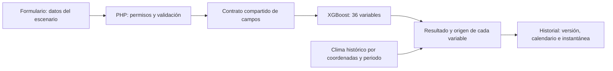

# Conexiones de simulación, consumo y evaluación de XGBoost

Revisión del 8 de noviembre de 2026, Ecuador. Trabajo sobre el código y el dataset local; no equivale a validar la cosecha de una parcela.

## Resultado funcional

El formulario, PHP y Flask comparten `backend-api/data/referencias/entradas-campo.json`. Se añadieron once parámetros opcionales que ya tienen columna compatible entre las 36 variables de XGBoost: duración, densidad, lámina de riego, tipo de riego, P₂O₅, K₂O, materia orgánica, profundidad del suelo, semilla certificada y temperaturas mínima/máxima. Se validan tipos, magnitudes, enteros y coherencia con la temperatura media en las tres capas. Cero se conserva como dato; vacío significa ausencia. Un dato declarado para el escenario no se presenta como medición verificada de forma independiente.

La fecha de siembra se propone desde la parcela y se puede modificar para planificar. El fin orientativo se calcula incluyendo el primer día y respetando años bisiestos. XGBoost recibe `ciclo_dias`; la fecha no se convierte en una columna nueva que el modelo nunca entrenó. El calendario y las entradas adicionales quedan guardados en el historial, dentro de la instantánea de la simulación, sin migrar el esquema de MySQL.

## Consumo y variedades

El catálogo `2026-11-07.3` tiene **14 fichas**: 13 materiales con etiqueta utilizable por el predictor y una ficha de canguil para consulta. Los tres tipos heredados del modelo se conservan, con etiquetas del formulario más claras. El destino alimentario está separado de esas categorías.

| Destino documentado | Ejemplos del catálogo |
| --- | --- |
| Choclo blanco | INIAP 101, 102, 103 y 111 |
| Choclo amarillo | INIAP 122 y 124 |
| Maíz duro amarillo | H-551, H-553, H-554 Renacer, H-603 Superior y DK-7088 |
| Grano andino | INIAP 180 Morochillo e INIAP 199 Racimo de Uva; los otros andinos conservan sus usos documentados |
| Canguil | INIAP 198, ficha con 2400–2900 m y 235 días orientativos; estimación específica bloqueada |

La reincorporación de INIAP 198 responde al requisito del usuario de cubrir canguil. Su ficha está respaldada por el [plegable INIAP](https://repositorio.iniap.gob.ec/handle/41000/2556) y el [registro AGRIS de FAO](https://agris.fao.org/search/es/records/6878df7e5d9ad5f58d60424c). El CSV contiene 49 filas de ese nombre clasificadas como maíz suave; no se aprovechan para declarar una simulación compatible de canguil. El bloqueo existe en PHP y en Flask. Ni el volumen de reventado ni las toneladas de choclo se deducen de la salida del modelo de grano.

Se mantienen **24 opciones retiradas**; el registro de retiros documenta la reincorporación y los motivos restantes. No es un ranking nacional de popularidad actual.

## Referencias y clima

Para completar entradas ausentes se excluyen duplicados y filas con contradicciones detectadas. De 2366 filas originales, 1970 superan los controles del experimento. Eso no acredita su origen ni garantiza que sean cosechas reales. El archivo original y los modelos de producción se conservan. Las comprobaciones detectan 296 filas con algún problema; los conteos por motivo se solapan: 201 inconsistencias térmicas, 58 de textura con tolerancia de dos puntos porcentuales y 49 filas de canguil mal clasificado. Hay además 100 duplicados adicionales. Los conteos de textura difieren de la auditoría inicial porque utilizan una tolerancia explícita diferente.

Las referencias imputadas se identifican como procedentes del conjunto de entrenamiento de origen sin acreditar. Una provincia asumida no dispara recomendaciones regionales de fertilización o adaptación. Las entradas fuera del rango observado del entrenamiento conservan su advertencia.

El productor puede solicitar contexto climático de su periodo. La [API histórica de Open-Meteo](https://open-meteo.com/en/docs/historical-weather-api) recibe coordenadas y fechas concretas; solo se consultan días pasados disponibles, dejando dos días de margen. La lluvia se presenta como total del periodo únicamente cuando están todas las fechas y todos los valores. La respuesta distingue periodo parcial, falta de coordenadas/fecha, periodo futuro y proveedor no disponible. El reanálisis es una referencia de malla, no un pluviómetro del lote. Este resumen no sustituye automáticamente el escenario ingresado ni proyecta lluvia para meses futuros.

## Asistente conectado al mismo escenario

El borrador que recibe el chatbot ahora distingue `precipitacion_ciclo_entrada_mm` de la lluvia anual del contrato anterior. Conserva cero, fecha y parámetros de manejo, e incluye la ficha y las restricciones de uso de la variedad. No presenta el borrador como simulación ejecutada ni el agua de riego como lluvia. Para preguntas sobre registros anteriores recupera calendario, periodo y manejo de la instantánea guardada.

Se corrigió el presupuesto de contexto para retirar primero referencias auxiliares y conservar el borrador en JSON válido. El prompt no debe recibir una cadena cortada en medio de sus datos. Las fuentes y notas extensas se reducen antes que los valores del escenario. Las pruebas comprueban el contexto enviado; no equivalen a validar todas las respuestas generadas por el proveedor.

## Experimento de XGBoost

Resultados reproducibles y parámetros completos: `documentacion/evaluacion-xgboost-20261108.json`. Se usaron los mismos 1970 registros elegibles, cuatro particiones externas por provincia y tres internas para elegir parámetros. Los codificadores se ajustan únicamente con entrenamiento. Se compararon tres configuraciones con semilla 42 y una mediana de referencia. Se registran versiones, huellas, parámetros y errores por provincia. Los artefactos quedan aislados en `ml-engine/experimentos/` y no entran al paquete para docentes.

| Contrato evaluado | RMSE referencia (t/ha) | RMSE ajuste (t/ha) | MAE ajuste (t/ha) |
| --- | ---: | ---: | ---: |
| 36 variables actuales | 1,0616 | 1,0556 | 0,8225 |
| Planificación sin NDVI ni presión/control de plagas de etapas futuras | 1,1895 | 1,1774 | 0,9047 |

La primera diferencia es aproximadamente 0,006 t/ha en esta evaluación interna. No demuestra una mejora agrícola significativa ni permite reemplazar el modelo con confianza. Tampoco se compara directamente con el RMSE histórico publicado, porque cambian la muestra y las particiones. El contrato de planificación se evalúa por separado: no se confunde disponer de datos de etapas futuras durante entrenamiento con conocerlos al sembrar.

No se publicó el candidato. La procedencia sigue sin acreditar y faltan cosechas externas con lugar, variedad, fecha, área, manejo y producción. `retrain_models.py` ahora detiene una publicación cuando falla la calidad o no existe un manifiesto de procedencia verificada vinculado al SHA-256. `--force` no evita ese control. Para investigar sin publicar: `python ml-engine/scripts/optimizar_xgboost.py --depuracion-experimental`.

Se aplicó la [skill ml-pipeline](C:/Users/aldai/.codex/skills/ml-pipeline/SKILL.md), cuyo flujo exige: “Run schema checks and distribution validation before any training begins; halt and report on failures”. El ensayo excluye explícitamente filas inválidas en una copia en memoria y conserva las limitaciones de procedencia. Los datos originales no se reparan inventando valores.

## Activación y comprobaciones

El usuario reinició el motor con `scripts/reiniciar_motor_ia.bat`. Se comprobó la versión activa **2.3.0**, contrato de campos **1.0**, y una petición real de prueba sin guardar en la cuenta confirmó duración, densidad, cero de riego y semilla. El build actualizado está copiado a XAMPP.

Las pruebas HTTP usan MySQL desechable y un motor aislado: comprueban paso de campos, calendario, persistencia y bloqueo de canguil incompatible. Las pruebas de navegador cubren móvil, tableta y escritorio en claro/oscuro, fechas y ficha de canguil. La evaluación estadística del ensayo no equivale a validación con cosechas reales.

Resultados comprobados: 35 pruebas frontend, 59 del motor Python, 142 de validación PHP, 12 del catálogo, 35 del chat y los otros grupos del verificador general correctos; 19 recorridos HTTP con base desechable; siete pruebas nuevas de navegador y tres de portada. Lint, comprobación de tipos del piloto y build finalizaron correctamente. Se inspeccionaron capturas de móvil/claro y escritorio/oscuro.

El paquete `ZeaSys-revision-docentes-20261108.zip` incluye las fuentes actualizadas, contratos, evidencia del experimento y cinco PDF. Se comprobó extraído en este equipo con una base nueva: registro, sesión, perfil, foto, parcela, simulación e historial. No equivale a una prueba en otra máquina limpia; el asistente todavía requiere configurar sus servicios y credenciales en esa máquina. Los experimentos no se empaquetan como modelos activos.

## Escalones siguientes

1. Obtener y documentar observaciones reales de cosecha; el usuario indicó que aún no las tiene. El importador/evaluador `ml-engine/scripts/evaluar_cosechas_verificadas.py` sigue disponible para medir el error por región/campaña.
2. Completar la revisión manual de cifras críticas del OCR y ampliar las pruebas de respuestas documentales del asistente.
3. Comprobar instalación en otra computadora limpia y recuperación completa. El ensayo del paquete en este equipo no sustituye esa prueba.
4. Evaluar el contrato de planificación con datos que estén disponibles al momento de sembrar; promover un nuevo modelo solo con evidencia comparable y procedencia acreditada.
